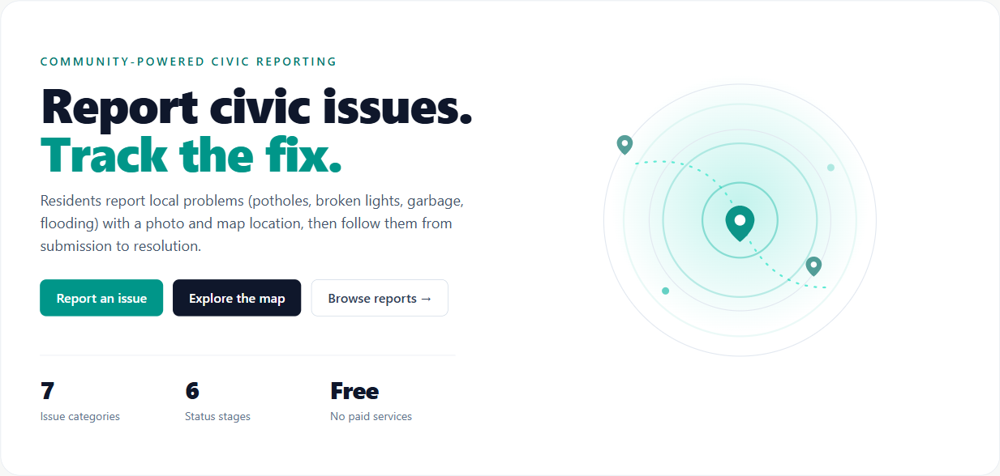

# CivicFix

A full-stack community problem reporting platform. Residents report local civic
issues (potholes, broken lights, garbage, flooding) with a photo and a map pin,
neighbours confirm and discuss them, admins verify and route them to the right
department, and departments resolve them. Every report is tracked end to end
through an explicit status lifecycle with in-app notifications.

[](https://civicfix-mu.vercel.app)
&nbsp;&nbsp;
[](https://civicfix-api.fly.dev/health)



## Demo logins

The live demo is seeded with data. Sign in with any of these accounts (all use
the password **`Password123!`**):

| Role              | Email                               | What they can do                            |
| ----------------- | ----------------------------------- | ------------------------------------------- |
| Super admin       | `super@civicfix.local`              | Everything, plus assign user roles          |
| Admin             | `admin@civicfix.local`              | Verify, assign, moderate, view analytics    |
| Department worker | `worker.publicworks@civicfix.local` | Act on reports assigned to their department |
| Citizen           | `citizen1@civicfix.local`           | Report issues, confirm, upvote, comment     |

## Features

- **Map-first reporting.** Every report carries precise GPS coordinates set by
  dropping a pin, plus a photo whose image type is verified server-side.
- **Community verification.** Residents upvote and confirm reports, surfacing
  the issues that matter most.
- **Transparent status lifecycle.** Reports move through a six-stage workflow
  (Submitted, Under review, Verified, Assigned, In progress, Resolved), and every
  transition is recorded with who changed it and when.
- **Department routing.** Admins assign issues to the responsible department;
  department workers only see and act on their own department's reports.
- **Notifications.** Subscribers are notified in-app on every status change.
- **Analytics.** Admin dashboard with reports by status, severity, category,
  department workload, and a monthly trend.
- **Role-based access control.** Four roles enforced in the API, not just the UI.

## Screenshots

The image above is the landing page. A full walkthrough (interactive map, reports
feed, report detail with status history, the report form, admin dashboard,
analytics, and moderation) is in **[`docs/screenshots/`](docs/screenshots)**.

## Tech stack

- **Backend:** Node + Express + TypeScript, Prisma ORM, PostgreSQL 16 + PostGIS,
  JWT auth (httpOnly cookie access token + rotating refresh token), argon2id
  hashing, Multer + magic-byte upload validation, Zod, Vitest + supertest.
- **Frontend:** Next.js 16 (App Router) + React 19 + TypeScript + Tailwind v4,
  React-Leaflet + OpenStreetMap, Vitest + React Testing Library.
- **Hosting (free tier):** Neon (Postgres + PostGIS), Fly.io (API), Vercel (web).

## Architecture notes

- **Status state machine.** All report status changes flow through one guarded
  transition that enforces the legal moves, the role permitted to make them, the
  required side effects (assignment, resolved timestamp, duplicate target), and
  always writes a status-history row.
- **Role-based access control.** The role lives in a signed JWT. The API
  enforces access in three layers: authentication, a coarse role gate per route,
  and resource-level ownership checks (for example, a department worker can only
  act on reports assigned to their own department). The frontend mirrors this for
  UX only; the API is the real boundary.
- **Geospatial.** `location geography(Point,4326)` is derived from latitude and
  longitude by a database trigger and indexed with GiST. Nearby and bounding-box
  map queries use PostGIS.
- **Auth.** Short-lived access JWT in an httpOnly cookie, plus an opaque rotating
  refresh token stored only as a SHA-256 hash and revocable server-side.
- **Uploads.** Image type is verified by magic bytes rather than the client
  content-type, size-capped, and stored with random keys.
- **Same-origin proxy.** In production the web app proxies `/api` and `/uploads`
  to the API, so the browser stays same-origin and the httpOnly auth cookies work.

## Prerequisites

- Node.js 20+
- Docker Desktop (for PostgreSQL + PostGIS)

## Quick start

```bash
# 1. Database (PostgreSQL + PostGIS on host port 5434)
docker compose up -d

# 2. Backend
cd backend
cp .env.example .env            # adjust secrets as needed
npm install
npx prisma generate
npx prisma migrate deploy       # apply schema + PostGIS trigger/index
npm run seed                    # demo data (optional but recommended)
npm run dev                     # http://localhost:5000

# 3. Frontend (in a second terminal)
cd frontend
cp .env.example .env.local      # NEXT_PUBLIC_API_URL defaults to localhost:5000
npm install
npm run dev                     # http://localhost:3000
```

Open http://localhost:3000.

## Testing

```bash
cd backend && npm test      # integration + unit tests (real Docker DB)
cd frontend && npm test     # component tests (Vitest + React Testing Library)
```

The backend suite runs against the Docker database, so make sure
`docker compose up -d` is running and migrations are applied first.

## Project structure

```
backend/
  prisma/                 schema, migrations (PostGIS), seed.ts
  src/
    config/               validated env
    lib/                  prisma, errors, http envelope, uploads, sanitize
    middleware/           requireAuth/requireRole, rate limiting
    modules/
      auth/               register/login/logout/refresh/me, tokens, password
      reports/            CRUD, geo (PostGIS), status-machine
      community/          comments, votes, subscriptions
      admin/              workflow, analytics, users + catalog CRUD
      notifications/      status-change notifications
      users/              self-service profile (/users/me)
frontend/
  app/                    App Router pages (public, citizen, admin, department)
  components/             UI primitives, cards, map, charts, providers
  lib/                    api client, types, formatting, map helpers
```

## Environment variables

**Backend (`backend/.env`)**, see `backend/.env.example`:

- `DATABASE_URL`: Postgres connection (matches docker-compose, port 5434)
- `DATABASE_URL_UNPOOLED`: connection used by Prisma Migrate. Locally the same
  as `DATABASE_URL`; on Neon, the direct (non `-pooler`) connection string
- `JWT_ACCESS_SECRET`: long random string (required)
- `JWT_ACCESS_EXPIRES_IN` (default `15m`), `REFRESH_TOKEN_TTL_DAYS` (default `7`)
- `CORS_ORIGIN` (default `http://localhost:3000`)
- `TRUST_PROXY_HOPS`: reverse proxies in front of the API (default `0`; `1` on Fly)
- `PROXY_SHARED_SECRET`: optional, 32+ chars, same value as the web app's; lets
  IP rate limits see the real client behind the web proxy
- `MAX_UPLOAD_BYTES` (default 5 MB), `LOCAL_UPLOAD_DIR` (default `uploads`)
- Rate limits: `RATE_LIMIT_REPORTS_PER_HOUR`, `RATE_LIMIT_COMMENTS_PER_HOUR`,
  `RATE_LIMIT_AUTH_PER_15MIN`

**Frontend (`frontend/.env.local`)**, see `frontend/.env.example`:

- `NEXT_PUBLIC_API_URL`: backend base URL (default `http://localhost:5000/api/v1`)
- `PROXY_SHARED_SECRET` (production): same value as the API's; sent by
  `proxy.ts` on auth routes

## Deployment (free tier)

Three services: a managed Postgres + PostGIS database, the API, and the web app.
Recommended free hosts: **Neon** (DB), **Fly.io** (API), **Vercel** (web).
Fly keeps one machine always on, so there are no cold starts.

### 1. Database: Neon

1. Create a project at [console.neon.tech](https://console.neon.tech) in the
   region closest to the API. This deployment uses AWS Singapore
   (`aws-ap-southeast-1`), next to Fly's `sin` region.
2. Copy two connection strings from **Connect**:
   - **Pooled** (host contains `-pooler`): this is `DATABASE_URL`, used by the app.
   - **Direct** (no `-pooler`): this is `DATABASE_URL_UNPOOLED`, used by Prisma Migrate.

   Append `&connect_timeout=15` to both. Neon scales an idle database to zero,
   and the extra time lets the first query wake it instead of timing out.
   With the [Neon CLI](https://neon.com/docs/reference/neon-cli), `neon link`
   then `neon env pull` writes both into `.env.local` at the repo root.

3. From your machine, apply the schema once (the migration enables PostGIS itself):
   ```bash
   cd backend
   export DATABASE_URL="<pooled-uri>" DATABASE_URL_UNPOOLED="<direct-uri>"
   npx prisma migrate deploy
   npm run seed   # optional demo data
   ```

### 2. API: Fly.io

Install [`flyctl`](https://fly.io/docs/flyctl/install/) and `fly auth login`, then:

```bash
cd backend
fly launch --no-deploy --copy-config   # uses fly.toml; pick a unique app name if taken
fly secrets set \
  DATABASE_URL="<neon-pooled-uri>" \
  DATABASE_URL_UNPOOLED="<neon-direct-uri>" \
  JWT_ACCESS_SECRET="$(openssl rand -hex 32)" \
  PROXY_SHARED_SECRET="$(openssl rand -hex 32)" \n  CORS_ORIGIN="https://<your-app>.vercel.app"   # fill in after step 3
fly deploy
```

`Dockerfile` builds the image and `fly.toml` keeps one 512 MB machine always on
with a `/health` check. You get a URL like `https://civicfix-api.fly.dev`.

### 3. Web: Vercel

- Add New, Project, import this repo, **Root Directory: `frontend`**.
- Environment variables:
  - `BACKEND_URL` = your Fly URL (e.g. `https://civicfix-api.fly.dev`)
  - `NEXT_PUBLIC_API_URL` = `/api/v1`
  - `PROXY_SHARED_SECRET` = the same value you set on Fly
- Deploy. `next.config.ts` proxies `/api/*` and `/uploads/*` to the backend, so
  the browser stays same-origin and the httpOnly auth cookies work.

Vercel redeploys automatically on every push to `main`; redeploy the API with
`fly deploy`.

| Where  | Variable                | Value                                          |
| ------ | ----------------------- | ---------------------------------------------- |
| Fly    | `DATABASE_URL`          | Neon pooled connection URI (`fly secrets set`) |
| Fly    | `DATABASE_URL_UNPOOLED` | Neon direct connection URI (`fly secrets set`) |
| Fly    | `JWT_ACCESS_SECRET`     | long random string (`fly secrets set`)         |
| Fly    | `CORS_ORIGIN`           | your Vercel URL (`fly secrets set`)            |
| Fly    | `NODE_ENV` / `PORT`     | `production` / `8080` (preset in `fly.toml`)   |
| Fly    | `TRUST_PROXY_HOPS`      | `1` (preset in `fly.toml`)                     |
| Fly    | `PROXY_SHARED_SECRET`   | random 32+ chars (`fly secrets set`)           |
| Vercel | `PROXY_SHARED_SECRET`   | same value as on Fly                           |
| Vercel | `BACKEND_URL`           | your Fly URL                                   |
| Vercel | `NEXT_PUBLIC_API_URL`   | `/api/v1`                                      |

> **Free-tier notes:** Fly requires a card on file but keeps a single small
> machine effectively free; `min_machines_running = 1` avoids cold starts.
> Neon's free plan suspends the database compute after 5 minutes idle and
> wakes it automatically on the next connection, so the first request after a
> quiet spell takes a moment longer. Uploaded images
> live on the machine's ephemeral disk, so they are cleared on redeploy. Attach
> a Fly volume, or wire up Cloudinary or another object store in
> `backend/src/lib/uploads.ts`, if you need them to persist.
